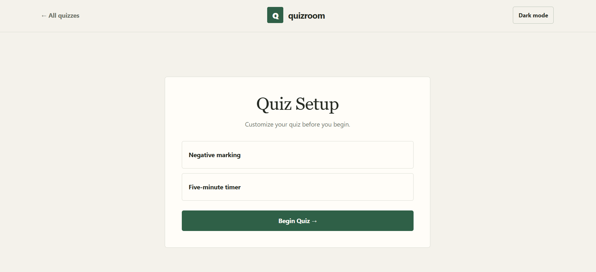
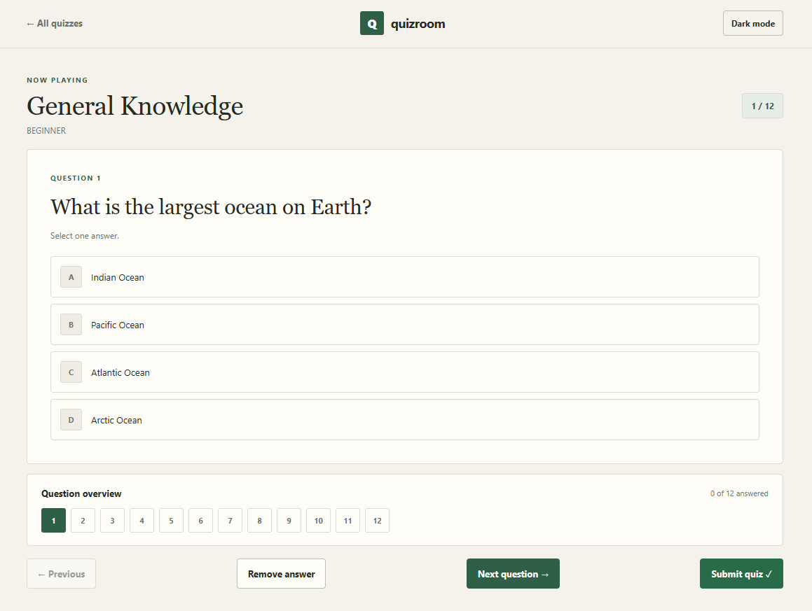
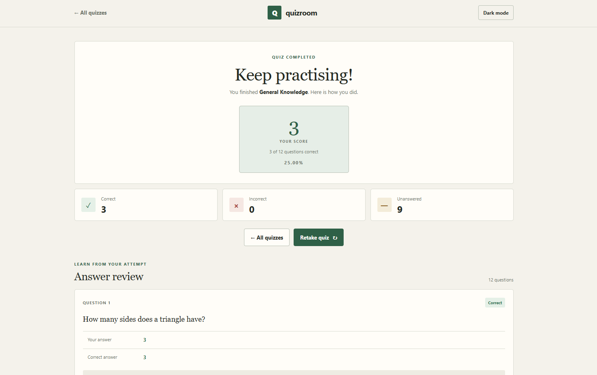
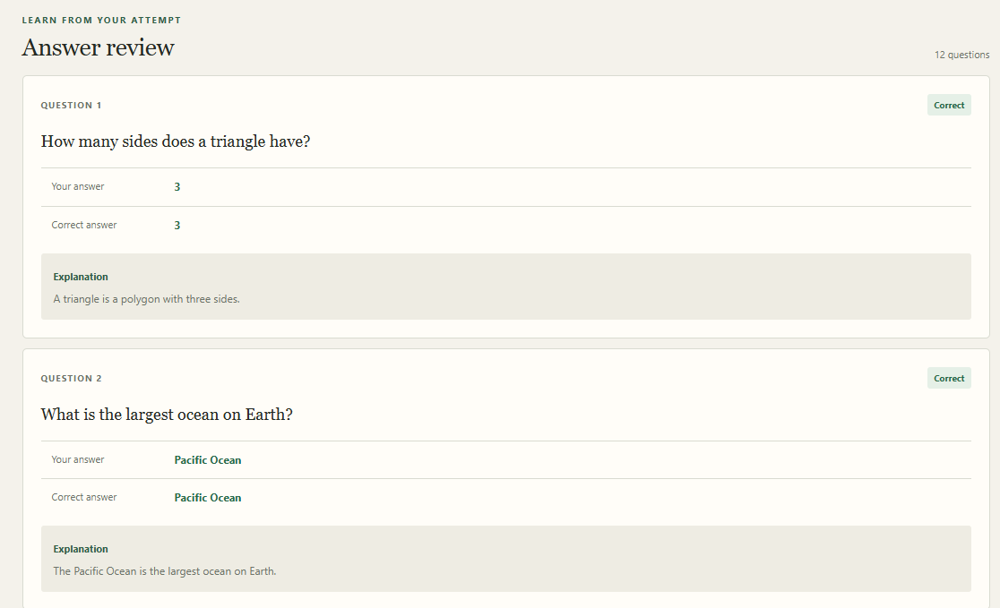

# QuizRoom

A React quiz application. Choose one of the three available quizzes, answer the questions, and review your results.

**Live demo:** [https://quiz-room-delta.vercel.app](https://quiz-room-delta.vercel.app)

## Screenshots

### Quiz selection

The landing page lists the three quizzes with their difficulty and question count. Available in both dark and light mode.

**Dark mode**


**Light mode**


### Quiz setup

Choose whether to enable negative marking and the five-minute timer before starting.



### Taking a quiz

One question at a time, with a question overview for jumping between questions, Previous / Next navigation, Remove answer, and Submit quiz.



### Results

Your score, percentage, and the correct / incorrect / unanswered counts, with options to retake the quiz or return to the list.



### Answer review

Every question with your answer, the correct answer, and an explanation.



## Overview

QuizRoom is a small, self-contained quiz tool. It supports three quizzes loaded from JSON files: **Programming Basics**, **General Knowledge**, and **Current Affairs**. You choose a quiz, set two options (negative marking and timer), work through the questions, and get a results page showing your score, a correct/incorrect/unanswered breakdown, and every question with your answer, the correct answer, and the explanation.

Questions and options are shuffled on every attempt. Answers are stored by question ID, so you can jump around without losing progress. Scoring respects the negative-marking option you chose at the start.

## Features

### Working

- Choose from three quizzes
- Optional negative marking (−0.25 per wrong answer)
- Optional 5-minute countdown that auto-submits at zero
- Shuffled question order and option order
- Select, change, or remove an answer on any question
- Previous / Next navigation plus a numbered question map showing which questions are answered
- Submit at any time
- Results screen with numeric score, percentage, correct/incorrect/unanswered counts, and a full review of every question (including explanations)
- Dark mode toggle that applies across all screens
- Retake the quiz or return to the quiz list

### Future improvements

- Leaderboard page that stores and displays scores from previous attempts
- Ability to create and add new quizzes
- Customisable time limits so the quiz duration can be set by the user
- User accounts so people can log in and save their progress

## Tech stack

- **React**: component state, conditional rendering of the four screens (selection, setup, quiz, results), and the timer effect
- **TypeScript**: typed quiz IDs, question shape, and answer map
- **Vite**: development server and build
- **CSS**: custom properties for light/dark theming, layout, and responsive adjustments (no CSS framework)

Quiz data lives in plain JSON files imported at build time.

## How QuizRoom works

1. The landing screen shows the three quiz cards. Clicking one calls `startQuiz`, which shuffles the questions and their options, resets answers, and opens the setup screen.
2. On the setup screen, toggle negative marking and/or the five-minute timer, then click **Begin Quiz**.
3. The quiz screen renders one question at a time. Answers are stored in a `Record<string, string>` keyed by question ID, and the question map lets you jump directly to any question. If enabled, the timer decrements every second via `setTimeout` and forces submission when it reaches zero.
4. Submitting (or timer expiry) switches to the results screen. The score is:

   ```
   score = correctCount - (negativeMarking ? incorrectCount * 0.25 : 0)
   ```

   Unanswered questions are not penalised. The review list walks the same shuffled array, looks up the saved answer, and marks each item correct, incorrect, or unanswered.

## Installation and setup

**Prerequisites:** Node.js 18+ and npm.

```bash
git clone https://github.com/emmanuvel439/QuizRoom.git
cd QuizRoom
npm install
npm run dev
```

Open the URL Vite prints (usually http://localhost:5173). No environment variables or extra services are required.

Or skip the setup and try the deployed version: [quiz-room-delta.vercel.app](https://quiz-room-delta.vercel.app).

## How to use the application

1. Open the site and pick a quiz card.
2. On the setup screen, turn negative marking and/or the five-minute timer on or off, then click **Begin Quiz**.
3. Answer the questions. Use the numbered map to jump around, the **Remove answer** button to clear a selection, or Previous/Next to move sequentially. If the timer is on, it appears above the question.
4. Click **Submit quiz** when finished, or wait for the timer to expire.
5. Review your score, the three metric cards, and the per-question breakdown. Retake the quiz or return to the list.
